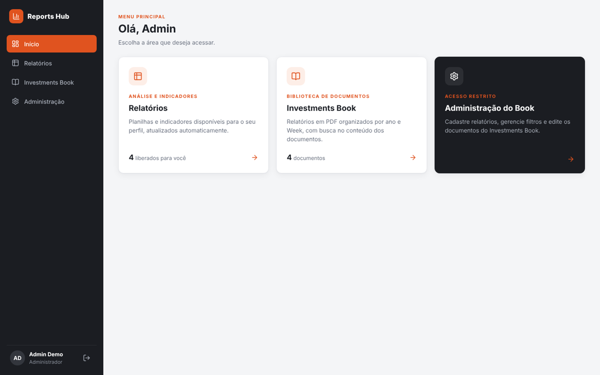
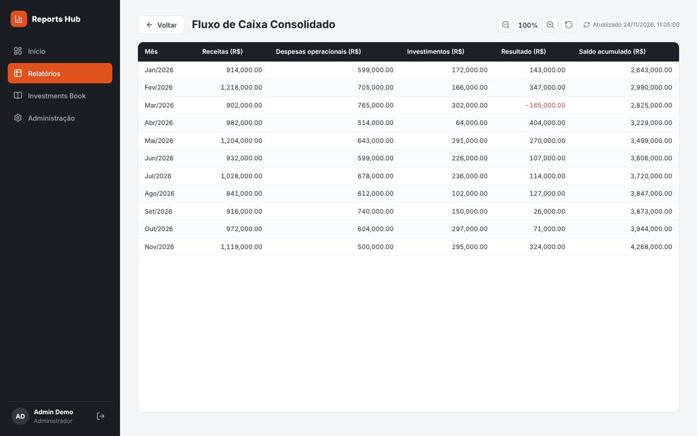
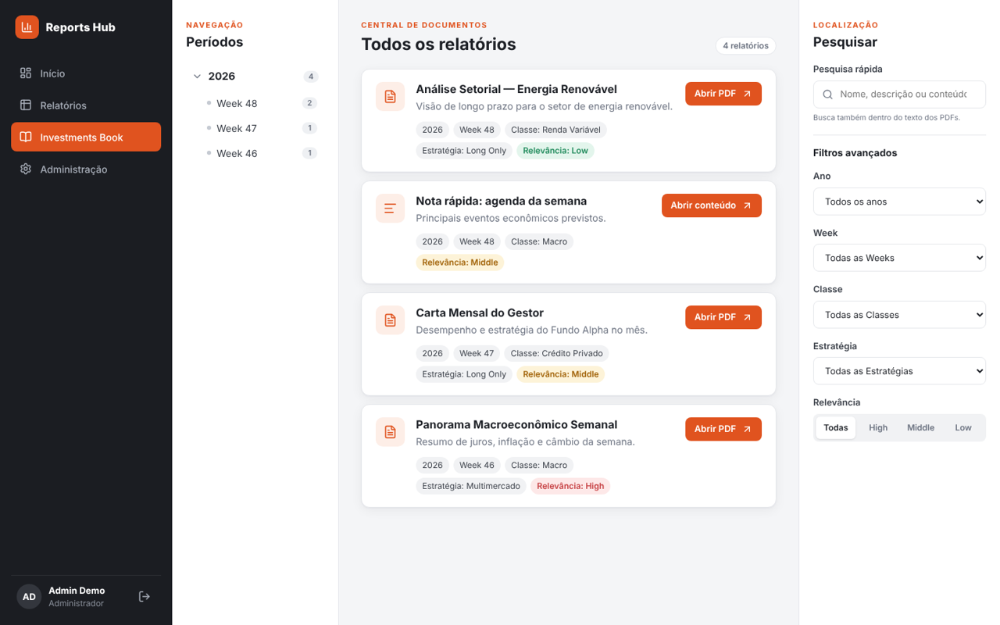
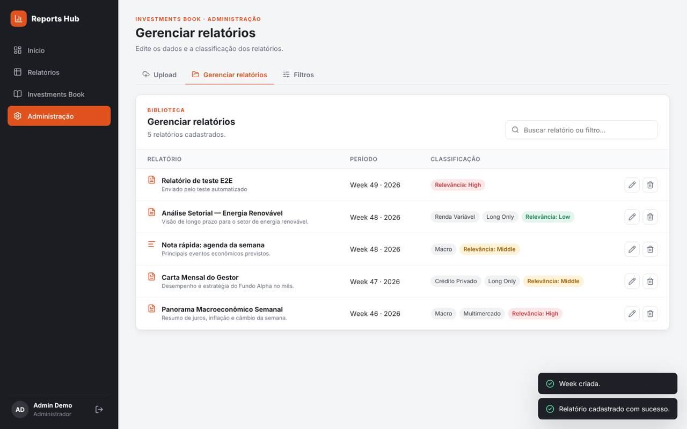
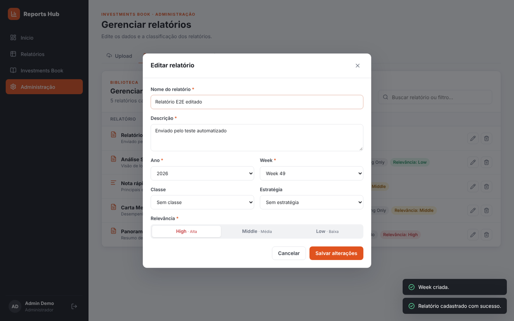
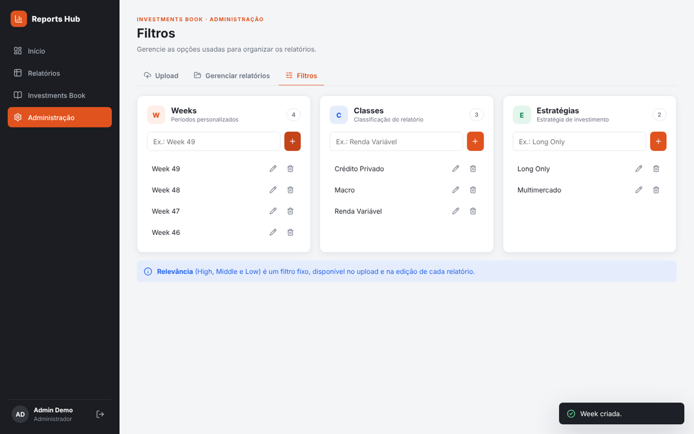
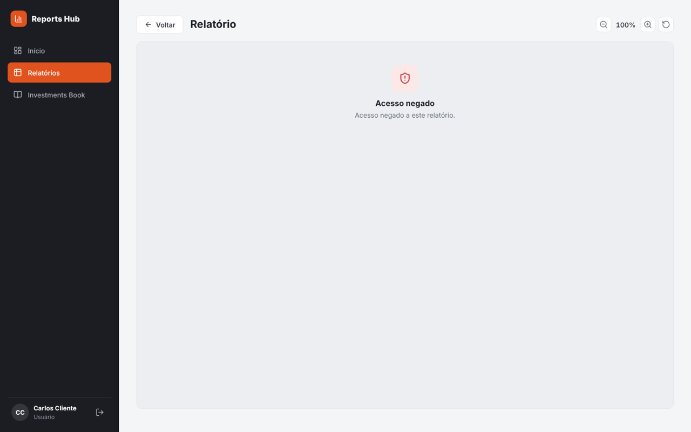

# Reports Hub

Portal de relatórios com **controle de acesso por usuário** e uma **biblioteca de documentos pesquisável** (Investments Book).
SPA em **React** (Vite + React Router) com API em **Node.js / Express**.

> Projeto desenvolvido originalmente para uso interno em uma empresa do mercado financeiro. Esta é a versão pública: dados, e-mails, credenciais, links de planilhas e identidade visual foram removidos e substituídos por dados fictícios. Assim, qualquer pessoa consegue rodar e testar localmente.



---

## O problema

A empresa precisava que diferentes pessoas (gestores, analistas, clientes) acessassem **planilhas atualizadas em tempo real** em um único portal, mas **cada uma só podia ver os relatórios liberados para ela**. Depois surgiu uma segunda demanda: uma central para **importar, classificar e pesquisar relatórios em PDF**, alimentada por administradores.

## Funcionalidades

**Relatórios com permissão por usuário**
- Login com JWT. O servidor filtra a lista e bloqueia (HTTP 403) qualquer relatório fora das permissões do usuário, mesmo que a pessoa digite a URL direto.
- Visualizador de planilha com zoom (botões ou teclas `+` `-` `0`), arrastar com o mouse e **atualização automática a cada 15 s**.
- Suporte a planilhas incorporadas (Excel Online, Google Sheets publicado etc.).

**Investments Book**
- Navegação por ano → Week, com contagem de documentos.
- Busca instantânea no nome, na descrição, nos filtros e **no texto extraído de dentro dos PDFs**.
- Filtros combináveis: ano, Week, Classe, Estratégia e Relevância.
- Visualização do PDF na própria página, com URL compartilhável (`/book?doc=ID`).

**Painel administrativo** (só para `admin`)
- Upload com arrastar e soltar, validação de tipo e tamanho.
- Tabela de gerenciamento com edição em modal e exclusão com confirmação.
- CRUD dos filtros (Weeks, Classes, Estratégias).

| Planilha | Investments Book |
|---|---|
|  |  |

| Gerenciar relatórios | Edição |
|---|---|
|  |  |

| Filtros | Acesso negado (usuário sem permissão) |
|---|---|
|  |  |

---

## Tecnologias

| Camada | Stack |
|---|---|
| Front-end | React 19, Vite, React Router 7, lucide-react, CSS puro com design tokens |
| Back-end | Node.js, Express 5, JWT, bcryptjs, multer, pdfjs-dist |
| Persistência | Arquivos JSON (sem banco, para rodar com zero configuração) |
| Monorepo | npm workspaces + concurrently |

### Decisões de arquitetura

- **A autorização fica no servidor.** O front só esconde menus por conveniência. Quem decide o que cada usuário pode ver e alterar são os middlewares `requireAuth` e `requireAdmin` da API.
- **Estado de autenticação centralizado** em um `AuthContext`, com rotas protegidas (`<ProtectedRoute adminOnly />`) e logout automático quando o token expira (evento `auth:expired` disparado pelo cliente HTTP).
- **Feedback global** (toasts, confirmação, prompt) via `FeedbackContext` com API baseada em Promise: `await confirm({...})`. Substitui `alert`/`confirm`/`prompt` nativos.
- **Hooks reutilizáveis**: `useBookData` (carregamento e recarga dos dados do Book) e `useZoomPan` (zoom, arrastar e atalhos do visualizador).
- **Planilhas "em tempo real"**: o servidor lê o CSV a cada requisição e devolve a data de modificação. O cliente faz polling e só re-renderiza quando o arquivo mudou.

---

## Como rodar

Pré-requisito: **Node.js 20.19+** (ou 22.12+).

```bash
git clone https://github.com/SEU-USUARIO/reports-hub.git
cd reports-hub
npm install
cp server/.env.example server/.env      # Windows: copy server\.env.example server\.env
```

**Modo desenvolvimento** (hot reload no front e no back):

```bash
npm run dev
```
Abra **http://localhost:5173**. O Vite redireciona `/api` e `/auth` para a API na porta 4000.

**Modo produção** (build do React servido pelo Express):

```bash
npm start
```
Abra **http://localhost:4000**.

Na primeira execução, o servidor cria automaticamente os usuários de demonstração e o Investments Book com PDFs de exemplo.

### Usuários de demonstração

Na tela de login há um atalho que preenche os dados ao clicar.

| E-mail | Senha | Perfil | Relatórios liberados |
|---|---|---|---|
| `admin@demo.com` | `admin123` | admin | todos + painel do Book |
| `analista@demo.com` | `analista123` | user | Fundo Alpha, Fundo Beta, Fluxo de Caixa |
| `cliente@demo.com` | `cliente123` | user | Fundo Beta |
| `visitante@demo.com` | `visitante123` | user | nenhum (só consulta o Book) |

### Roteiro de teste

1. Entre como **admin** e abra **Investments Book** e **Administração** em duas abas.
2. Na aba de administração, vá em *Filtros* e crie uma Week. Depois, em *Upload*, envie um PDF qualquer.
3. Na aba do Book, atualize a página: o documento aparece na árvore de períodos e já pode ser encontrado pela busca, inclusive por palavras de dentro do PDF.
4. Saia e entre como **cliente**: só o Fundo Beta aparece, o menu de administração some, e abrir `/relatorios/fundo-alpha` mostra "Acesso negado".
5. Com o app aberto em um relatório, edite um CSV em `server/data/sheets/` e salve. Em até 15 s a tabela se atualiza sozinha.

---

## Usuários e permissões

Os usuários ficam em `server/data/users.json`, com as senhas guardadas como hash bcrypt. Gerencie pelo terminal:

```bash
npm run user -- list
npm run user -- reports                                   # IDs disponíveis
npm run user -- add maria@empresa.com senha123 --nome "Maria" --acessos fundo-alpha,fluxo-caixa
npm run user -- add chefe@empresa.com senha123 --nome "Chefe" --role admin --acessos "*"
npm run user -- access maria@empresa.com fundo-beta
npm run user -- role maria@empresa.com admin
npm run user -- password maria@empresa.com novaSenha
npm run user -- remove maria@empresa.com
```

As alterações valem na hora. `npm run seed` restaura os dados de demonstração.

## Adicionando planilhas

Catálogo em `server/data/reports.json`:

```json
[
  { "id": "fundo-alpha", "title": "Fundo Alpha", "tipo": "csv", "arquivo": "fundo-alpha.csv", "descricao": "Posição diária" },
  { "id": "planilha-online", "title": "Planilha Online", "tipo": "embed", "url": "https://link-de-incorporacao" }
]
```

- `csv`: arquivo em `server/data/sheets/` (separador `,` ou `;`).
- `embed`: qualquer URL exibível em `iframe`, como o link de incorporação do Excel Online/SharePoint ou do Google Sheets ("Publicar na Web"). Era assim que a versão original mostrava as planilhas da empresa.

---

## Estrutura

```
reports-hub/
├── client/                         # React (Vite)
│   └── src/
│       ├── App.jsx                 # rotas
│       ├── lib/
│       │   ├── api.js              # cliente HTTP com JWT
│       │   ├── book.js             # regras de filtro/ordenação + useBookData
│       │   └── useZoomPan.js
│       ├── context/                # AuthContext, FeedbackContext
│       ├── components/             # AppLayout, ProtectedRoute, Modal, ...
│       ├── pages/
│       │   ├── Login, Home, Reports, ReportViewer
│       │   ├── book/               # BookPage, PeriodTree, FilterPanel, DocumentViewer
│       │   └── admin/              # AdminPage, UploadTab, ManageTab, FiltersTab
│       └── styles/
└── server/                         # API Express
    ├── server.js
    ├── src/
    │   ├── auth.js                 # login, JWT, requireAuth / requireAdmin
    │   ├── users.js                # usuários, bcrypt, permissões
    │   ├── reports.js              # planilhas (filtradas por acesso)
    │   ├── book.js                 # Investments Book (CRUD, upload, busca)
    │   └── microsoft.js            # SSO Microsoft 365 (comentado)
    ├── scripts/                    # CLI de usuários e seed
    ├── seed/                       # dados e PDFs de demonstração
    └── data/                       # catálogo e planilhas CSV
```

## API

| Método | Rota | Acesso | Descrição |
|---|---|---|---|
| POST | `/auth/login` | público | `{ email, senha }` → `{ token, user }` |
| GET | `/auth/user` | logado | usuário e permissões |
| GET | `/api/reports` | logado | relatórios liberados para o usuário |
| GET | `/api/reports/:id` | com acesso | dados da planilha ou URL de embed |
| GET | `/api/book/reports` | logado | relatórios do Book |
| GET | `/api/book/search` | logado | busca por `nome`, `ano`, `weekId`, `classeId`, `estrategiaId`, `relevancia` |
| POST | `/api/book/upload` | admin | cadastro (multipart, campo `pdf`) |
| PUT / DELETE | `/api/book/reports/:id` | admin | edição / exclusão |
| GET · POST · PUT · DELETE | `/api/book/weeks` · `/classes` · `/strategies` | leitura: logado · escrita: admin | filtros |

---

## Login com Microsoft 365 (opcional)

A versão original usava **SSO com Microsoft Entra ID (Azure AD)**: o usuário entrava com a conta corporativa, e o e-mail retornado era cruzado com a lista de permissões. O código continua no projeto, comentado. Para reativar:

1. Registre um app no portal do Azure (Microsoft Entra ID → Registros de aplicativo) com redirect `http://localhost:4000/auth/microsoft/callback`.
2. Preencha `CLIENT_ID`, `CLIENT_SECRET`, `TENANT_ID` e `REDIRECT_URI` em `server/.env`.
3. `npm install passport passport-microsoft express-session -w server`
4. Descomente `server/src/microsoft.js`, as linhas de `setupMicrosoftLogin` em `server/server.js` e o botão "Entrar com Microsoft" em `client/src/pages/Login.jsx`.

O callback devolve o token para `/login?token=...`, e o front já trata esse caso.

---

## Observações

- As senhas de demonstração aparecem no README e na tela de login de propósito. Em produção, defina um `JWT_SECRET` forte e crie usuários próprios.
- Todos os dados (fundos, valores, PDFs) são fictícios.
