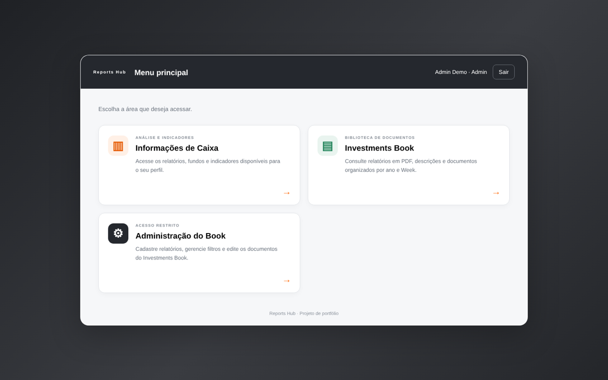
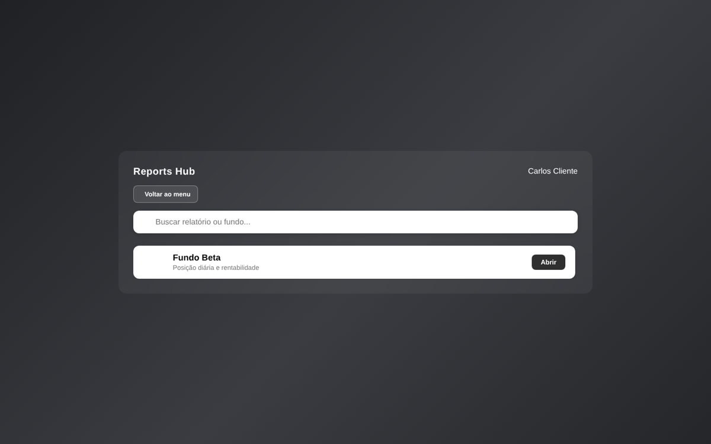
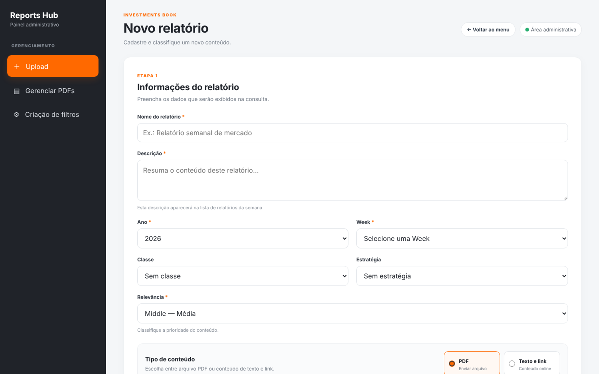

# Reports Hub

Portal web de relatórios com **controle de acesso por usuário** e uma **biblioteca de documentos pesquisável** (Investments Book), feito em Node.js + Express e JavaScript puro no front-end.

> Projeto desenvolvido originalmente para uso interno em uma empresa do mercado financeiro. Esta é uma versão pública: dados, e-mails, credenciais, links de planilhas e identidade visual foram removidos e substituídos por dados fictícios, para que qualquer pessoa consiga rodar e testar localmente.


---

## O problema

A empresa precisava que diferentes pessoas (gestores, analistas, clientes) acessassem **planilhas atualizadas em tempo real** em um único portal, mas **cada uma só podia ver os relatórios liberados para ela**. Depois surgiu uma segunda demanda: uma central para **importar, classificar e pesquisar relatórios em PDF**, alimentada por administradores.

## A solução

### 1. Portal de relatórios com permissões
- Login com e-mail e senha (a versão original usava SSO com Microsoft 365, veja [Login com Microsoft](#login-com-microsoft-365-opcional)).
- Cada usuário tem uma lista de relatórios liberados. O servidor só devolve e só abre o que está nessa lista. O front-end nunca recebe nada que o usuário não pode ver.
- Visualizador de planilha com **zoom, arrastar (pan)** e **atualização automática a cada 15 s**: altere o CSV no disco e a tela se atualiza sozinha.
- Suporte a planilhas incorporadas (Excel Online, Google Sheets publicado etc.) via `embed`.

### 2. Investments Book (biblioteca de PDFs)
- Navegação por **ano → Week**.
- **Pesquisa rápida** que busca no nome, na descrição, nos filtros e **no texto extraído do próprio PDF**.
- **Filtros avançados**: ano, Week, Classe, Estratégia e Relevância (High / Middle / Low).
- Visualização do PDF direto na página.
- **Painel administrativo** (apenas admins): upload de PDF ou conteúdo de texto + link, edição e exclusão de relatórios, e criação de filtros (Weeks, Classes, Estratégias).

| Menu principal | Relatórios de um usuário com acesso limitado |
|---|---|
|  |  |

| Visualizador de planilha | Investments Book |
|---|---|
|  |  |



---

## Tecnologias

- **Back-end:** Node.js, Express 5, JWT (`jsonwebtoken`), `bcryptjs`, `multer` (upload), `pdfjs-dist` (extração de texto dos PDFs)
- **Front-end:** HTML, CSS e JavaScript puro (sem framework)
- **Persistência:** arquivos JSON (sem banco de dados, para facilitar rodar localmente)

---

## Como rodar

Pré-requisito: **Node.js 18 ou superior**.

```bash
git clone https://github.com/SEU-USUARIO/reports-hub.git
cd reports-hub
npm install
cp .env.example .env      # no Windows: copy .env.example .env
npm start
```

Na primeira execução o servidor cria automaticamente os usuários de demonstração e o Investments Book com PDFs de exemplo.

No terminal aparecem os endereços:

```
Servidor rodando em http://localhost:4000
  Relatórios:         http://localhost:4000/
  Investments Book:   http://localhost:4000/book/index.html
  Painel admin Book:  http://localhost:4000/book/pages/admin.html
```

### Usuários de demonstração

| E-mail | Senha | Perfil | Relatórios liberados |
|---|---|---|---|
| `admin@demo.com` | `admin123` | admin | todos (`*`) + painel do Book |
| `analista@demo.com` | `analista123` | user | Fundo Alpha, Fundo Beta, Fluxo de Caixa |
| `cliente@demo.com` | `cliente123` | user | Fundo Beta |
| `visitante@demo.com` | `visitante123` | user | nenhum (só consulta o Book) |

### Testando o Investments Book como admin

1. Rode `npm start` no terminal.
2. Abra `http://localhost:4000` e entre com `admin@demo.com` / `admin123`.
3. No menu principal aparecem os três cards. Abra em **duas abas diferentes**:
   - **Investments Book** (`/book/index.html`): a tela de consulta.
   - **Administração do Book** (`/book/pages/admin.html`): o painel de upload.
4. No painel, faça upload de um PDF qualquer, escolha ano, Week e relevância, e salve.
5. Volte à aba do Book e atualize a página: o relatório aparece na árvore de períodos e já pode ser encontrado pela pesquisa, inclusive por palavras do conteúdo do PDF.

Entre com `visitante@demo.com` para ver que o card de administração some e que a API recusa qualquer alteração (HTTP 403).

---

## Gerenciando usuários e permissões

Os usuários ficam em `data/users.json`, com as senhas guardadas como hash bcrypt. Use o script de linha de comando:

```bash
npm run user -- list                                   # lista usuários e acessos
npm run user -- reports                                # lista os IDs de relatórios
npm run user -- add maria@empresa.com senha123 --nome "Maria" --acessos fundo-alpha,fluxo-caixa
npm run user -- add chefe@empresa.com senha123 --nome "Chefe" --role admin --acessos "*"
npm run user -- access maria@empresa.com fundo-beta    # troca os relatórios liberados
npm run user -- role maria@empresa.com admin           # promove a admin
npm run user -- password maria@empresa.com novaSenha   # troca a senha
npm run user -- remove maria@empresa.com
```

- `role`: `admin` (acessa o painel do Book) ou `user`.
- `acessos`: lista de IDs de relatórios, ou `*` para todos.

As alterações valem na hora, sem reiniciar o servidor.

Para voltar ao estado inicial (usuários e Book de demonstração): `npm run seed`.

---

## Adicionando relatórios (planilhas)

O catálogo fica em `data/reports.json`:

```json
[
  { "id": "fundo-alpha", "title": "Fundo Alpha", "tipo": "csv", "arquivo": "fundo-alpha.csv", "descricao": "Posição diária" },
  { "id": "planilha-online", "title": "Planilha Online", "tipo": "embed", "url": "https://link-de-incorporacao-da-planilha" }
]
```

- **`csv`**: o arquivo fica em `data/sheets/`. O servidor lê o arquivo a cada requisição, então qualquer alteração no CSV aparece na tela em até 15 s. Aceita separador `,` ou `;`.
- **`embed`**: qualquer URL que possa ser exibida em `iframe`, como o link de incorporação do Excel Online/OneDrive/SharePoint ou do Google Sheets ("Publicar na Web"). Era assim que a versão original exibia as planilhas em tempo real.

Depois de criar o relatório, libere-o para os usuários com `npm run user -- access ...`.

---

## Estrutura

```
reports-hub/
├── server.js              # ponto de entrada do Express
├── src/
│   ├── auth.js            # login, JWT e middlewares (requireAuth / requireAdmin)
│   ├── users.js           # leitura de usuários, senha (bcrypt) e permissões
│   ├── reports.js         # API das planilhas (filtra pelo acesso do usuário)
│   ├── book.js            # API do Investments Book (CRUD, upload, busca)
│   ├── microsoft.js       # login Microsoft 365 (comentado)
│   ├── store.js           # leitura/escrita de JSON
│   └── paths.js
├── scripts/
│   ├── user.js            # CLI de usuários
│   └── seed.js            # dados de demonstração
├── seed/                  # usuários, Book e PDFs de exemplo
├── data/
│   ├── reports.json       # catálogo de relatórios
│   └── sheets/            # planilhas CSV de exemplo
├── uploads/               # PDFs enviados pelo painel (ignorado no git)
└── public/                # front-end (HTML/CSS/JS)
    ├── index.html         # login
    ├── page/              # menu principal, lista e visualizador de relatórios
    └── book/              # Investments Book e painel administrativo
```

## API

| Método | Rota | Acesso | Descrição |
|---|---|---|---|
| POST | `/auth/login` | público | `{ email, senha }` → `{ token, user }` |
| GET | `/auth/user` | logado | dados e permissões do usuário |
| GET | `/api/reports` | logado | relatórios liberados para o usuário |
| GET | `/api/reports/:id` | com acesso | dados da planilha ou URL de embed |
| GET | `/api/book/reports` | logado | todos os relatórios do Book |
| GET | `/api/book/search` | logado | busca com `nome`, `ano`, `weekId`, `classeId`, `estrategiaId`, `relevancia` |
| POST | `/api/book/upload` | admin | cadastro (multipart, campo `pdf`) |
| PUT / DELETE | `/api/book/reports/:id` | admin | edição / exclusão |
| GET / POST / PUT / DELETE | `/api/book/weeks`, `/classes`, `/strategies` | leitura: logado · escrita: admin | filtros |

O token JWT vai no header `Authorization: Bearer <token>`.

---

## Login com Microsoft 365 (opcional)

Na versão original, o login era feito via **SSO com Microsoft Entra ID (Azure AD)**: o usuário entrava com a conta corporativa e o e-mail retornado pela Microsoft era cruzado com a lista de permissões. O código continua no projeto, comentado, em `src/microsoft.js`. Para reativar:

1. Registre um app no [portal do Azure](https://portal.azure.com) (Microsoft Entra ID → Registros de aplicativo) com o redirect `http://localhost:4000/auth/microsoft/callback`.
2. Preencha `CLIENT_ID`, `CLIENT_SECRET`, `TENANT_ID` e `REDIRECT_URI` no `.env`.
3. `npm install passport passport-microsoft express-session`
4. Descomente o conteúdo de `src/microsoft.js`, as duas linhas de `setupMicrosoftLogin` em `server.js` e o botão "Entrar com Microsoft" em `public/index.html` e `public/js/login.js`.

Os usuários continuam sendo cadastrados em `data/users.json` (a senha não é usada nesse caso). Assim, só entra quem tiver o e-mail na lista.

---

## Observações

- As senhas de demonstração estão no README de propósito, para facilitar o teste. Em produção, defina um `JWT_SECRET` forte no `.env` e crie usuários próprios.
- Todos os dados (fundos, valores, PDFs) são fictícios.
